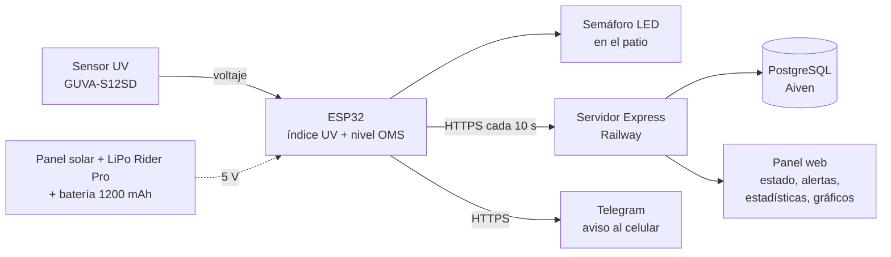

# Medidor UV para colegios – Semáforo de radiación ultravioleta

Sistema IoT que mide la radiación ultravioleta en el patio de un colegio, la muestra con un **semáforo de colores** según el **Índice UV de la OMS**, avisa al celular por **Telegram** y guarda cada lectura en una **base de datos en la nube** con un **panel web** público. Así el personal del colegio puede decidir en el momento cómo proteger a los niños en recreos y clases de Educación Física.

**Curso:** TEI201 – Taller de Diseño en Ingeniería · Universidad Adolfo Ibáñez · 2026
**Panel web en vivo:** https://sensor-uv-web-production.up.railway.app

---

## Equipo

| Integrante | Rol | GitHub |
|------------|-----|--------|
| [Nombre 1] | Código (firmware, servidor y panel web) y esquema electrónico | [@usuario] |
| Benito Díaz | [Rol] | @benito-diaz |
| [Nombre 3] | [Rol] | [@usuario] |
| [Nombre 4] | [Rol] | [@usuario] |

---

## Problema (Avance 1)

La exposición a la radiación UV durante la jornada escolar (recreos, Educación Física y actividades al aire libre) produce un daño acumulativo en la piel y los ojos de los niños. En los colegios de **Peñalolén** no existe un indicador **local y en tiempo real** que le diga al personal cuándo el nivel de radiación es peligroso y qué precauciones tomar.

**ODS principal:** ODS 3 – Salud y bienestar. **ODS secundario:** ODS 11 – Ciudades y comunidades sostenibles.

---

## Solución



| Paso del ciclo IoT | Qué hace el sistema |
|---|---|
| **Captura** | El ESP32 mide el sensor cada 0,5 s (promedio de 64 muestras) y calcula el índice UV con suavizado. |
| **Almacenamiento** | Cada 10 s manda la lectura a un servidor en Railway, que la guarda en PostgreSQL (Aiven). El historial queda disponible aunque se reinicie el equipo. |
| **Visualización** | Panel web con el valor actual, gráfico con las franjas de la OMS (1 h / 6 h / 24 h / 7 días), tabla y descarga CSV. |
| **Información útil** | Nivel OMS con su recomendación para el colegio, **alerta cuando UV ≥ 6**, máximo del día y su hora, tiempo con protección necesaria, número de alertas, máximo diario de 7 días. |
| **Decisión** | Semáforo en el patio + aviso en Telegram + panel: el personal decide recreo a la sombra, Educación Física bajo techo, bloqueador y gorro. |

| Índice UV (OMS) | Nivel | Semáforo | Qué hacer en el colegio |
|---|---|---|---|
| 0 – 2 | Bajo | Verde | Recreo y Ed. Física al aire libre sin restricciones |
| 3 – 5 | Moderado | Amarillo | Bloqueador y gorro; preferir sombra al mediodía |
| 6 – 7 | Alto | Rojo fijo | Recreo en sombra; Ed. Física bajo techo u otro horario |
| 8 – 10 | Muy alto | Rojo parpadeo lento | Evitar el sol; recreo bajo techo o sombra total |
| 11 o más | Extremo | Rojo parpadeo rápido | Suspender actividades al aire libre |

---

## Dónde está cada criterio de la rúbrica

| Dimensión | Criterio | Dónde mirarlo |
|---|---|---|
| Software 30 % | Captura de datos | [`software/docs/captura_y_datos.md`](software/docs/captura_y_datos.md) |
| | Repositorio de datos | [`software/servidor/server.js`](software/servidor/server.js) y `captura_y_datos.md` |
| | Dashboard | [`software/servidor/public/index.html`](software/servidor/public/index.html) y link del panel |
| | Generación de información | `captura_y_datos.md`, sección 4 |
| | Calidad del código | [`software/README.md`](software/README.md) |
| Hardware 30 % | Selección de componentes | [`hardware/README.md`](hardware/README.md) |
| | Esquemático y BOM | [`hardware/esquemas/`](hardware/esquemas/) y [`hardware/bom/`](hardware/bom/) |
| | Montaje físico | [`hardware/fotos/`](hardware/fotos/) |
| | Diseño para la reparación | `hardware/README.md`, sección 5 |
| Diseño 3D 20 % | Gemelo 3D y modelo Fusion | [`diseno_3d/fusion360/`](diseno_3d/fusion360/) |
| | Funcionalidad del encapsulado | [`diseno_3d/README.md`](diseno_3d/README.md) |
| | Planos | [`diseno_3d/planos/Planos_Carcasa_v4.pdf`](diseno_3d/planos/Planos_Carcasa_v4.pdf) |
| | Renders | [`diseno_3d/renders/`](diseno_3d/renders/) |
| Testing 10 % | Protocolo, resultados y validación | [`testing/reportes/`](testing/reportes/) |
| GitHub 5 % | Estructura y respaldo | Este repositorio y su historial |
| Presentación 5 % | Slides y demo | [`documentacion/presentacion/`](documentacion/presentacion/) |
| Requisito | Fuentes e IA | [`FUENTES.md`](FUENTES.md) |

---

## Estructura del repositorio

```
├── FUENTES.md            Librerías, servicios, modelos de terceros y uso de IA
├── software/
│   ├── src/main.ino      Firmware del ESP32 (semáforo + Telegram + envío a la nube)
│   ├── servidor/         Servidor Express + panel web (se despliega en Railway)
│   ├── docs/             Captura y datos, capturas del panel
│   └── librerias/        Dependencias y versiones
├── hardware/             Esquemático, BOM con costos, fotos y justificación
├── diseno_3d/            Fusion 360 (.f3d), STL, planos PDF, renders, scripts
├── testing/              Protocolo, reporte de resultados, datos y evidencias
├── iteraciones/          Historial v1 → v4
└── documentacion/        Presentación final
```

---

## Inicio rápido

### Hardware
Componentes y conexiones en [`hardware/README.md`](hardware/README.md). Resumen: sensor S→D34, VCC→3V3, GND→GND; semáforo R→D25, Y→D26, G→D27, GND→GND; ESP32 alimentado por la salida USB de la LiPo Rider Pro (panel solar + batería).

### Firmware
1. Arduino IDE 2 + paquete **esp32 by Espressif Systems** + librería **ArduinoJson** (v7).
2. Abrir `software/src/main.ino` (Arduino pedirá crear la carpeta `main`: aceptar).
3. Completar el bloque `CONFIGURA ESTO`: WiFi de 2,4 GHz, token y chat ID de Telegram, `SERVER_URL` y `API_KEY`. **Nunca subir estos datos al repositorio.**
4. Placa **ESP32 Dev Module**, puerto COM y **Subir**. En el Monitor Serie (115200) debe aparecer `[Nube] POST ... -> 201`.

### Servidor y panel
Instrucciones completas en [`software/README.md`](software/README.md#servidor-y-panel-web). Resumen: base PostgreSQL **Free** en Aiven, proyecto en Railway desde el repositorio `sensor-uv-web`, variables `DATABASE_URL`, `DB_CA_CERT` y `API_KEY`, dominio con puerto 8080.

Probar sin hardware (con una base PostgreSQL propia):
```bash
cd software/servidor
cp .env.example .env      # completar con los datos reales
npm install
npm start                 # panel en http://localhost:3000
```

---

## Estado del proyecto

- **Versión actual:** v3 firmware / v4 carcasa (Avance 3)
- **Última actualización:** 22-11-2026
- **Estado:** prototipo funcional con captura, almacenamiento en la nube, panel web, avisos por Telegram y carcasa diseñada para la reparación con energía solar.

---

## Licencia

MIT. Proyecto desarrollado en el curso TEI201 – Facultad de Ingeniería y Ciencias – Universidad Adolfo Ibáñez.
