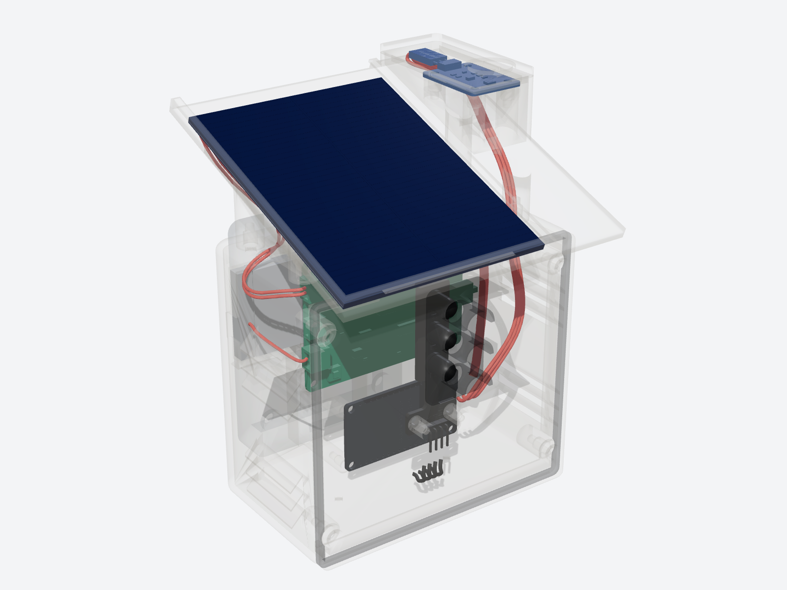
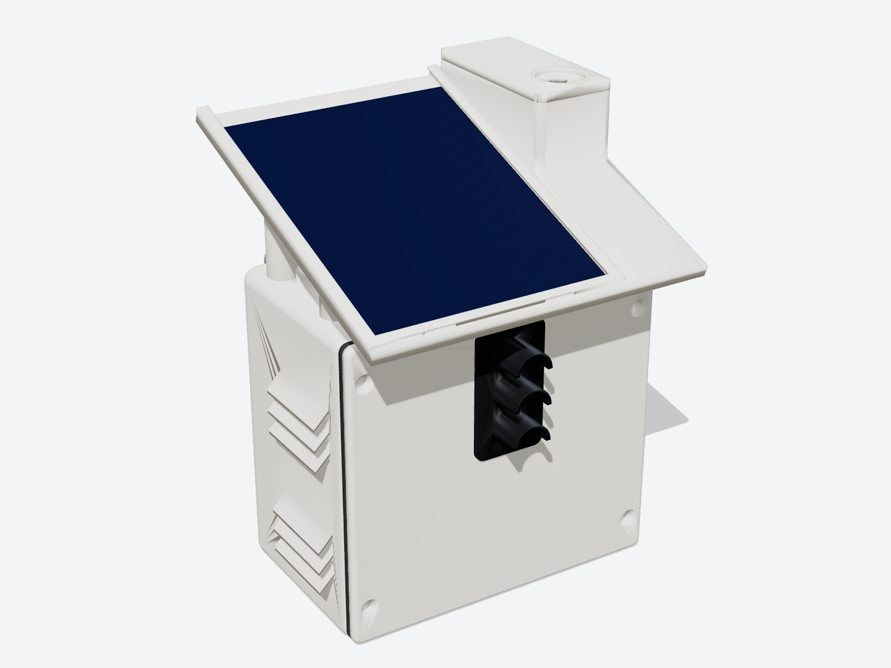
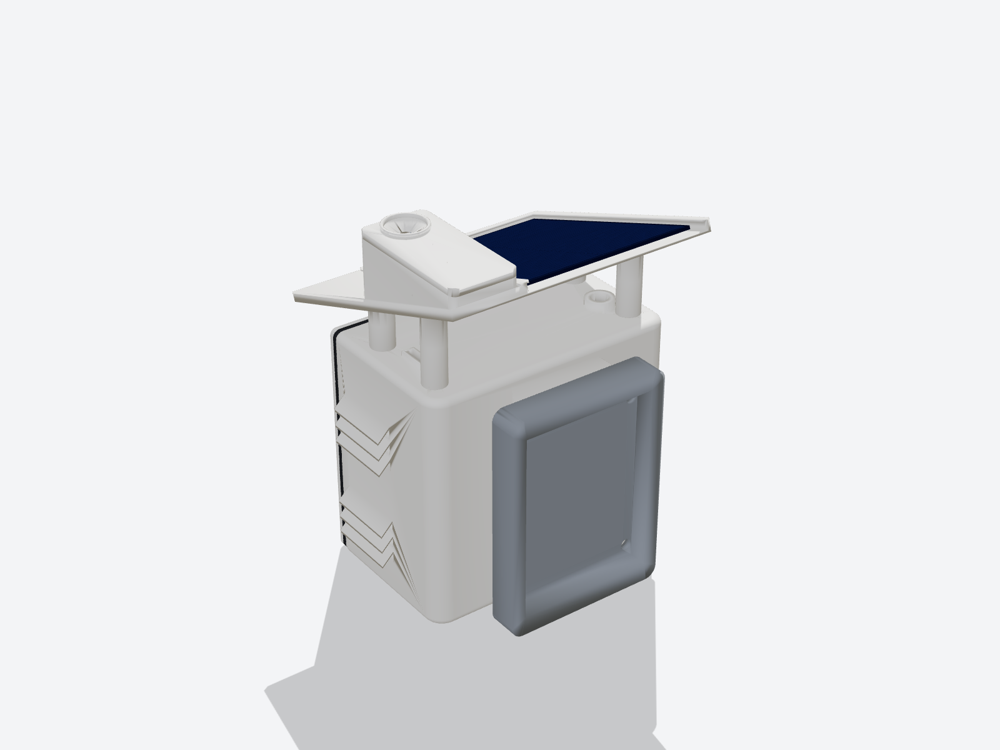
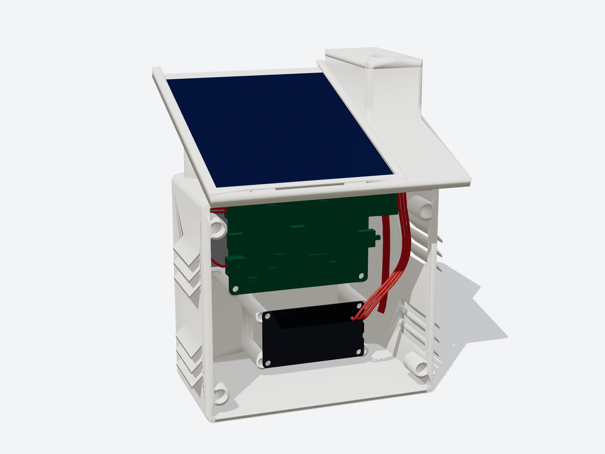
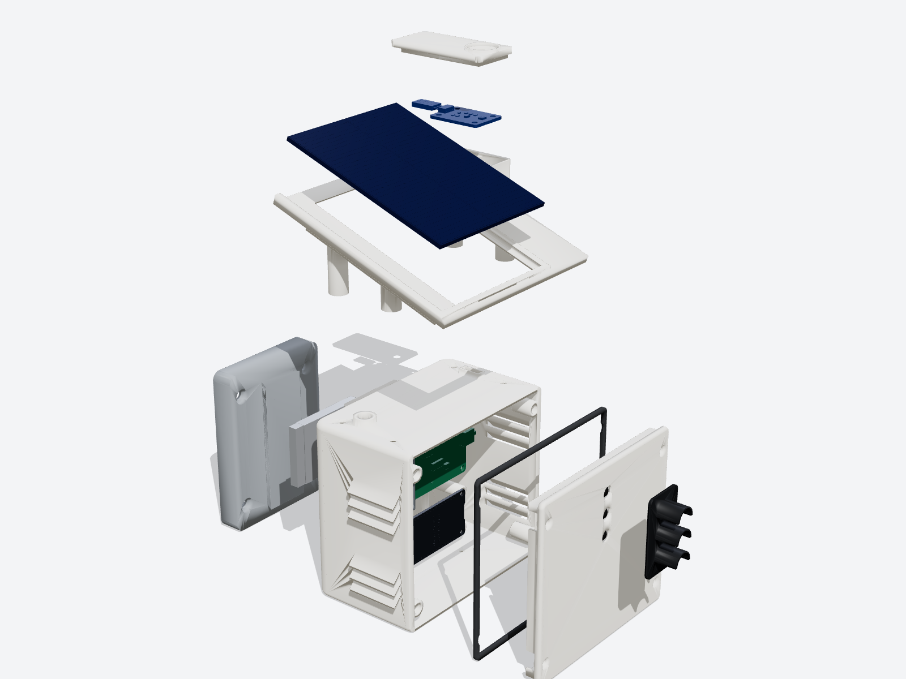

# Diseño 3D – Carcasa v4 (Avance 3)

## Carpetas

| Carpeta | Contenido |
|---|---|
| `fusion360/` | `Carcasa_v4_con_componentes.f3d` (**gemelo 3D**: carcasa + todos los componentes) y `Carcasa_v4.f3d` (solo carcasa) |
| `planos/` | `Planos_Carcasa_v4.pdf`: 4 láminas con vistas ortogonales, cotas, tolerancias y escala |
| `renders/` | Exterior frente y trasera, interior sin tapa, gemelo transparente y explosionado |
| `stl/` | Las 8 piezas listas para imprimir, con su material en el nombre |
| `scripts_fusion/` | Scripts de Python (API de Fusion) con los que se construyó la v4 |

---

## Gemelo 3D

El archivo `Carcasa_v4_con_componentes.f3d` incluye todos los componentes del sistema con su volumen y posición reales:

| Componente | Cómo está modelado | Dónde va |
|---|---|---|
| ESP32 DevKit 30 pines | Modelo STEP descargado (GrabCAD), agujeros corregidos a 51 × 23 mm medidos en la placa real | Parte baja, sobre 4 postes Ø7 con insertos M2.5 |
| LiPo Rider Pro | Volumen con medidas reales, agujeros 63 × 44,6 mm | Parte alta, 4 postes Ø8 con insertos M3, unidos al techo de la caja |
| Batería LiPo 603450 1200 mAh | Volumen 6 × 34 × 50 mm | Bolsillo en la pared trasera, sujeta con la traba |
| Panel solar 100 × 80 | Volumen | Techo, inclinado 20° |
| Sensor UV GUVA-S12SD | Volumen, agujeros 23 × 15 mm | Cápsula del techo, bajo la ventana abierta |
| Semáforo LED | Modelo STEP descargado (GrabCAD) | Tapa frontal, 2 tornillos M2.5 |
| Cables | Trayectorias (barridos) de batería, panel, USB y Dupont del sensor | Por dentro de la caja |

---

## Medidas generales

| | Medida |
|---|---|
| Total (ancho × fondo × alto) | **120 × 111,4 × 154,5 mm** |
| Caja | 110 × 73 × 104 mm (120 con persianas), pared 2,5 mm |
| Techo solar | 115 × 107,6 mm, panel a 20° |
| Volumen impreso | ≈ 262,5 cm³ |

## Piezas y materiales

| # | Pieza | Material | Por qué |
|---|---|---|---|
| 1 | Cuerpo | ASA blanco | ASA resiste los rayos UV y el calor al sol mejor que PLA y PETG; blanco refleja el calor |
| 2 | Tapa frontal | ASA blanco | Igual |
| 3 | Frente del semáforo | ASA negro | Contraste: los LED se ven mejor sobre fondo negro |
| 4 | Junta | TPU 95A | Flexible: sella la tapa contra la lluvia y el polvo |
| 5 | Techo solar | ASA blanco | Sostiene el panel y la cápsula del sensor; hace de alero |
| 6 | Tapa del sensor | ASA blanco | Ventana cónica abierta (Ø18 → Ø5): **sin vidrio**, porque el vidrio común bloquea el UV |
| 7 | Traba de batería | PETG gris | Pieza interior, no recibe sol |
| 8 | Soporte de pared | ASA gris | Queda fijo en la pared; la caja se desliza por la cola de milano |

---

## Funcionalidad del encapsulado

- **Protección:** junta TPU en la tapa; persianas a 45° con aleta (dejan salir el calor y no entra lluvia directa); techo que hace de alero; drenaje Ø3 en la cápsula del sensor.
- **Acceso:** la tapa frontal sale con 4 tornillos y deja a la vista el ESP32 (puerto USB), la LiPo Rider (interruptor) y la batería. El panel se saca deslizándolo.
- **Tolerancias:** ±0,2 mm generales de impresión FDM; insertos M3 en agujeros Ø5,0 y M2.5 en Ø3,5 (5 mm de profundidad); pasos de tornillo Ø3,4 (M3) y Ø4,0 en el techo; rieles del panel con 0,35 mm de holgura.
- **Reparación:** ver `hardware/README.md`, sección 5. Todo se arma con tornillos M3/M2.5 a insertos térmicos, sin pegamento en la electrónica.

---

## Renders

| | |
|---|---|
|  |  |
|  |  |

---

## Evolución del modelo

| Versión | Cambios principales |
|---|---|
| v1 (Avance 2) | Caja simple 113 × 116 × 76 mm, sin encajes ni tornillos |
| v2 | Energía solar, componentes reales, insertos M3 |
| v3 | Chasis interior en PETG, soporte de pared con cola de milano, techo solar a 20° |
| **v4 (final)** | Chasis integrado al cuerpo, insertos M2.5 para ESP32 y semáforo, se elimina la peineta Dupont y el tubo de cables, traba de batería movida 4 mm, pasos del techo a Ø4 mm, panel deslizante con tope continuo |

---

## Especificaciones

**Software:** Autodesk Fusion (licencia educativa) + scripts de Python con la API de Fusion (ver `FUENTES.md`)
**Unidades:** mm · **Escala:** 1:1
**Impresión sugerida:** ASA a 0,2 mm de capa, 4 perímetros, 25 % de relleno, cámara cerrada.
