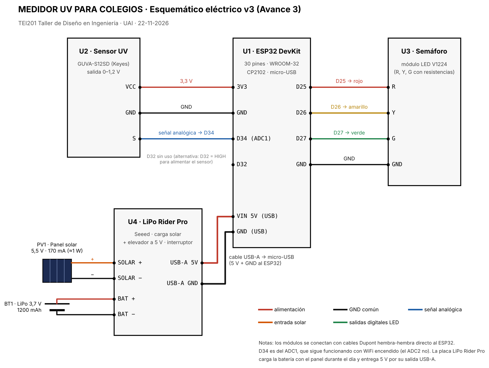

# Hardware – Documentación

## Contenido

| Carpeta | Contenido |
|---|---|
| `esquemas/` | **Esquemático v3** (`esquematico.pdf/.png/.svg`) con el sistema solar; esquema de conexiones del Avance 2 |
| `bom/` | Lista de materiales con cantidades, especificación y costos (`BOM.csv`) |
| `fotos/` | Fotos del prototipo ensamblado (mínimo 3 ángulos) |

---

## 1. Selección de componentes (justificación técnica)

| Componente | Por qué este | Rango / precisión | Consumo | Compatibilidad |
|---|---|---|---|---|
| **ESP32 DevKit 30 pines** (WROOM-32, CP2102) | WiFi integrado (no requiere módulo extra), 2 núcleos (semáforo y comunicaciones separados), ADC de 12 bits | ADC 0–3,1 V con atenuación 11 dB, 4096 niveles (~0,8 mV) | WiFi activo ≈ 95–100 mA al recibir, picos de 160–260 mA al transmitir (hoja de datos ESP32) | Lógica 3,3 V, igual que el sensor y el semáforo |
| **Sensor UV GUVA-S12SD** (Keyes) | Fotodiodo de nitruro de galio sensible solo a UV (≈240–370 nm, UVA + UVB), con amplificador ya montado: salida analógica directa | Salida ≈ 0,1 V por punto de índice UV → índice 0–11 en ~0–1,2 V, dentro del rango del ADC | < 1 mA | 3,3 V; una sola señal analógica |
| **Semáforo LED V1224** | Tres LED con resistencias incluidas; comunica el riesgo sin leer números, también a niños | 3 colores + parpadeo = 5 niveles OMS | ≈ 5–10 mA por LED encendido | Se maneja directo desde pines GPIO de 3,3 V |
| **Seeed LiPo Rider Pro** | En una sola placa: carga la batería con el panel, protege la batería y entrega 5 V por USB al ESP32. Tiene interruptor | Salida USB 5 V, hasta 1 A | — | Batería LiPo de 1 celda (3,7 V) con conector JST |
| **Batería LiPo 3,7 V 1200 mAh (603450)** | Plana (6 × 34 × 50 mm): cabe en el bolsillo de la pared trasera | ≈ 4,4 Wh | — | Conector JST a la LiPo Rider |
| **Panel solar 5,5 V 170 mA (100 × 80 mm)** | Voltaje compatible con la entrada solar de la LiPo Rider; su tamaño define el techo inclinado | ≈ 0,94 W en sol pleno | — | Conector a la entrada SOLAR |
| **Cables Dupont hembra-hembra** | Conexión sin soldadura; se cambian en segundos | — | — | Pines macho de los módulos y del ESP32 |

### Balance de energía (estimación, falta medir)
- Consumo estimado del sistema con WiFi siempre activo: ≈ 110 mA a 5 V ≈ **0,55 W**.
- Batería: 3,7 V × 1,2 Ah ≈ 4,4 Wh; con ~85 % de eficiencia del elevador ≈ 3,8 Wh útiles → **≈ 7 h de autonomía** sin sol.
- El panel entrega como máximo ≈ 0,9 W y solo en horas de sol pleno, así que **no alcanza para funcionar 24 h seguidas**.
- **Mejora propuesta:** dormir el ESP32 de noche (sin sol no hay UV que medir) y operar solo en horario escolar, o usar un panel de ≈ 2 W. La autonomía real se medirá en la prueba P6 (`testing/reportes/protocolo_pruebas.md`).

---

## 2. Esquemático

| Desde | Pin | Hacia | Señal |
|---|---|---|---|
| Sensor UV | S | ESP32 D34 | Analógica (ADC1) |
| Sensor UV | VCC / GND | ESP32 3V3 / GND | Alimentación 3,3 V |
| Semáforo | R / Y / G | ESP32 D25 / D26 / D27 | Digitales |
| Semáforo | GND | ESP32 GND | Tierra |
| Panel solar | + / − | LiPo Rider SOLAR | 5,5 V |
| Batería | + / − | LiPo Rider BAT | 3,7 V |
| LiPo Rider | USB-A | ESP32 micro-USB | 5 V + GND (cable USB) |

---

## 3. BOM

Ver [`bom/README.md`](bom/README.md) y [`bom/BOM.csv`](bom/BOM.csv).

---

## 4. Montaje

1. Con todo apagado (interruptor de la LiPo Rider en OFF), conectar sensor y semáforo al ESP32 con cables hembra-hembra según la tabla.
2. Revisar que **todos los GND** estén conectados (sin GND el sensor marca UV ≈ 4 a oscuras: falla real del Avance 2).
3. Conectar batería y panel a la LiPo Rider y el cable USB al ESP32.
4. Encender: el semáforo hace rojo → amarillo → verde y luego muestra el nivel actual.

⚠️ El VCC del sensor va a **3V3**, nunca a 5 V. ⚠️ No cortocircuitar la batería LiPo ni perforarla.

---

## 5. Diseño para la reparación

| Parte | Cómo se saca | Herramienta |
|---|---|---|
| Caja completa | Se levanta del soporte de pared (cola de milano) | Ninguna |
| Tapa frontal (con semáforo) | 4 tornillos M3 a insertos térmicos | Destornillador |
| ESP32 | 4 tornillos M2.5 a insertos; cables Dupont enchufables | Destornillador |
| LiPo Rider Pro | 4 tornillos M3 a insertos; batería y USB enchufables | Destornillador |
| Batería | Traba atornillada (2 M3) + conector JST | Destornillador |
| Sensor UV | Tapa del sensor a presión; 4 tornillos a insertos en la cápsula | Destornillador |
| Panel solar | Desliza por rieles desde el extremo alto | Ninguna |
| Techo solar | 4 pernos M3 desde dentro de la caja | Destornillador |

No hay pegamento en ningún componente electrónico (solo el frente negro del semáforo va pegado a la tapa). Los insertos térmicos permiten atornillar y desatornillar muchas veces sin gastar el plástico. Todas las fijaciones son **M3 o M2.5**: basta un destornillador.

---

## 6. Especificaciones

| Parámetro | Valor |
|---|---|
| Alimentación | Panel solar 5,5 V + batería LiPo 1200 mAh, o USB 5 V |
| Consumo | ≈ 0,55 W estimado (medir con medidor USB, prueba P6) |
| Dimensiones del encapsulado v4 | 120 × 111,4 × 154,5 mm (ver `diseno_3d/`) |
| Volumen impreso | ≈ 262,5 cm³ (ASA, PETG y TPU) |

---

## Troubleshooting

| Problema | Posible causa | Solución |
|---|---|---|
| Índice UV ≈ 4 a oscuras | GND del sensor desconectado | Revisar GND |
| Ninguna luz enciende | GND del semáforo suelto o cable dañado | Revisar GND; probar cada LED en 3V3 |
| El PC no detecta el ESP32 | Falta driver CP210x o cable solo de carga | Instalar driver / cambiar cable |
| El equipo se apaga de noche | Batería descargada | Cargar por USB en la LiPo Rider; ver balance de energía |
| Siempre UV 0 bajo techo | Normal: el vidrio bloquea el UV | Probar al aire libre |
