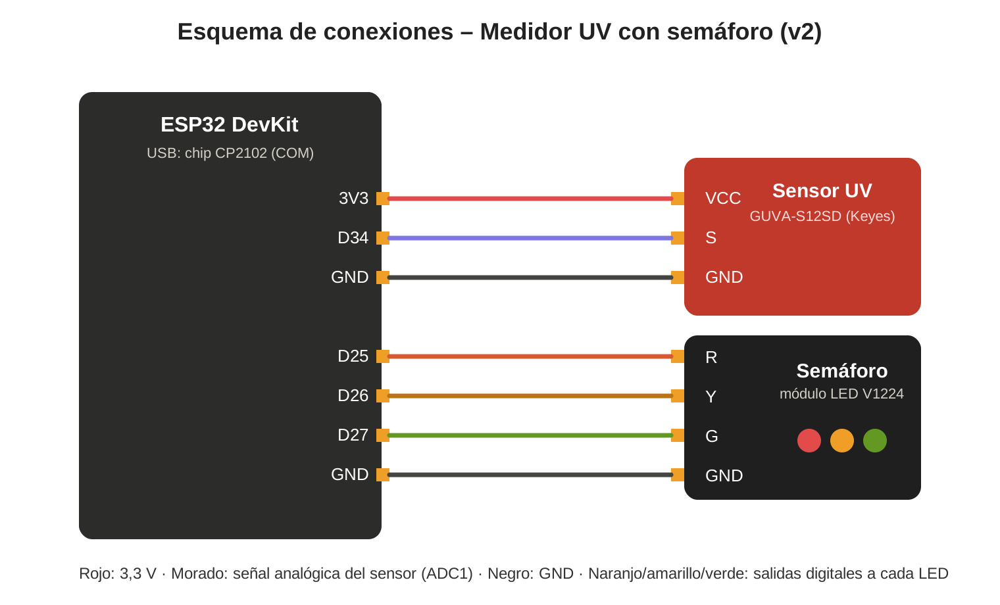

# Esquemas de Circuito

## Archivos

| Archivo | Descripción |
|---------|-------------|
| `esquema_conexiones.svg` | Esquema de conexiones v2 (editable) |
| `esquema_conexiones.png` | Exportación del esquema |

## Evolución de las conexiones (iteraciones)

| Versión | Montaje | Sensor VCC | Cambio y motivo |
|---------|---------|------------|-----------------|
| v2.0 – v2.1 (14/10) | Cables hembra-hembra directo al ESP32 | 3V3 | Primer circuito funcional |
| v2.2 (18/10) | ESP32 en protoboard; módulos afuera con cables hembra-macho y GND por el riel (−) | D32 (en 3,3 V por código) | Ordenar el cableado. El pin 3V3 quedó tapado por la protoboard. Hubo fallas de GND. Foto: [`04_prueba_protoboard.jpg`](../../testing/evidencias/04_prueba_protoboard.jpg) |
| v2.3 (18/10 – actual) | Cables hembra-hembra directo al ESP32 | 3V3 | Se volvió a la conexión directa por ser más confiable. Se agregó WiFi (sin cambios de cableado). |

## Notas de diseño

- **Conexión directa con cables hembra-hembra.** Se probó armar el circuito en protoboard, pero el ESP32 ocupa casi todo el ancho (solo queda una columna libre por lado) y los módulos del sensor y el semáforo tienen los pines hacia el costado, por lo que quedaban parados y frágiles. Además hubo fallas por GND sin conectar. Se volvió a la conexión directa, que resultó más confiable (ver `iteraciones/iteracion_2/`).
- **Sensor en D34 (ADC1):** el ADC2 no funciona con el WiFi activo.
- **GND común:** el ESP32 tiene dos pines GND; uno va al sensor y el otro al semáforo.
- **Pin D32:** el código lo deja en 3,3 V. Sirve para alimentar el sensor cuando el pin 3V3 no está accesible (por ejemplo, en protoboard).

## Pendiente
- [ ] Pasar el esquema a Wokwi o Fritzing (`wokwi_diagram.json` / `circuito_completo.fzz`) si el curso lo exige.
