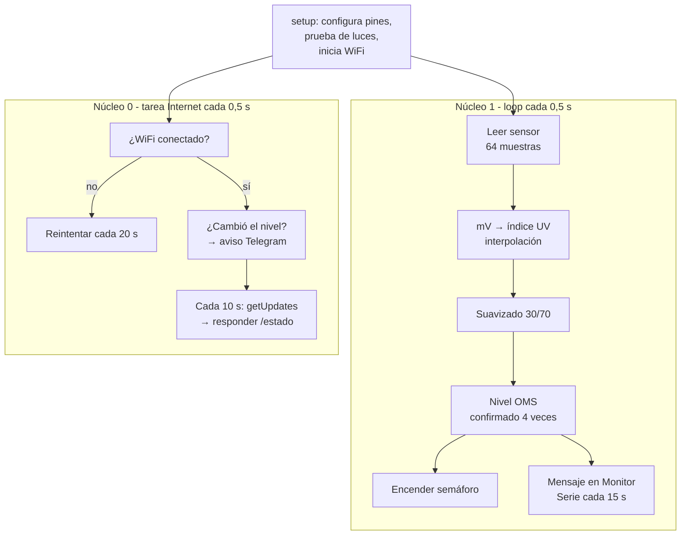

# Software – Documentación

## Contenido

| Carpeta | Contenido |
|---------|-----------|
| `src/` | Código fuente del ESP32 (`main.ino`) |
| `librerias/` | Librerías utilizadas (todas incluidas en el paquete del ESP32) |
| `docs/` | Manual de instalación, manual de operación y solución de problemas |

---

## Stack tecnológico

**Plataforma:** ESP32 (placa ESP32 DevKit, "ESP32 Dev Module")
**Lenguaje:** C/C++ (Arduino)
**IDE:** Arduino IDE 2.3.10
**Paquete de placas:** esp32 by Espressif Systems 3.3.12
**Librerías principales** (incluidas en el paquete, no hay que instalarlas):
- `WiFi.h` – conexión a la red WiFi
- `WiFiClientSecure.h` – conexión segura (HTTPS)
- `HTTPClient.h` – peticiones a la API de Telegram

---

## Instalación y configuración

### 1. Instalar Arduino IDE
Descargar Arduino IDE 2 desde https://www.arduino.cc/en/software e instalar con las opciones por defecto. Aceptar la instalación de los controladores USB.

### 2. Configurar el ESP32
1. **File → Preferences → Additional boards manager URLs:**
   `https://espressif.github.io/arduino-esp32/package_esp32_index.json`
2. **Tools → Board → Boards Manager**, buscar `esp32` e instalar **esp32 by Espressif Systems**.
3. Conectar el ESP32 con un cable USB **de datos**.
4. Si no aparece un puerto COM nuevo, instalar el driver **CP210x** de Silicon Labs ("CP210x Windows Drivers", ejecutar `CP210xVCPInstaller_x64.exe`).
5. **Select other board and port:** placa **ESP32 Dev Module** y el puerto COM del ESP32 (por ejemplo COM3).

### 3. Instalar librerías
No hace falta: todas vienen con el paquete del ESP32.

### 4. Cargar el código
1. Abrir `src/main.ino`.
2. Completar las credenciales (sección siguiente).
3. Presionar **Subir (→)**. Si se queda en `Connecting....`, mantener presionado el botón **BOOT** de la placa.
4. Abrir **Serial Monitor** a **115200 baud**.

---

## Configuración de parámetros

Al inicio de `main.ino`, en la sección `CONFIGURA ESTO`:

```cpp
const char* WIFI_NOMBRE      = "NOMBRE_DE_TU_RED";    // WiFi de 2,4 GHz
const char* WIFI_CLAVE       = "CLAVE_DE_TU_RED";
const char* TELEGRAM_TOKEN   = "PEGA_AQUI_EL_TOKEN";  // lo entrega @BotFather
const char* TELEGRAM_CHAT_ID = "PEGA_AQUI_TU_ID";     // ID del chat que recibe los avisos
```

> ⚠️ **No subir al repositorio** el token ni la clave real. Con el token cualquiera puede controlar el bot.

Otros parámetros ajustables:

| Constante | Valor | Qué controla |
|-----------|-------|--------------|
| `PIN_UV` | 34 | Pin de la señal del sensor (ADC1) |
| `PIN_ROJO / PIN_AMARILLO / PIN_VERDE` | 25 / 26 / 27 | Pines del semáforo |
| `PIN_VCC_SENSOR` | 32 | Pin que puede alimentar el sensor con 3,3 V |
| `MUESTRAS_POR_LECTURA` | 64 | Lecturas promediadas en cada medición |
| `INTERVALO_LECTURA_MS` | 500 | Cada cuánto se mide (ms) |
| `INTERVALO_MENSAJE_MS` | 15000 | Cada cuánto se imprime el mensaje en el Monitor Serie |
| `SUAVIZADO` | 0.3 | Peso de la lectura nueva en el promedio suavizado |
| `LECTURAS_PARA_CAMBIO` | 4 | Lecturas seguidas necesarias para cambiar de color |
| `TABLA_MV[]` | 12 valores | Voltaje típico del sensor para índice UV 0 a 11 |

---

## Arquitectura del software



### Módulos principales

1. **Inicialización (`setup`)** – configura pines y ADC (12 bits, atenuación 11 dB, rango ~0–3,1 V), hace la prueba de luces, inicia el WiFi y crea la tarea de Internet.
2. **Lectura de sensor (`leerMilivoltios`)** – promedia 64 lecturas calibradas en mV (`analogReadMilliVolts`).
3. **Procesamiento (`milivoltiosAIndiceUV`, `indiceANivel`, `actualizarNivel`)** – convierte a índice UV, suaviza y decide el nivel OMS con confirmación de 4 lecturas.
4. **Actuación (`mostrarNivel`, `mostrarMensaje`)** – enciende el LED correspondiente (con parpadeo en niveles 8+) e imprime el mensaje de recomendación.
5. **Comunicación (`tareaInternet`, `enviarTelegram`, `revisarTelegram`)** – avisos por Telegram y respuesta al comando `/estado`.

---

## API / Endpoints

El ESP32 no expone endpoints propios. Usa la API de Telegram como cliente:

| Endpoint de Telegram | Método | Uso |
|----------------------|--------|-----|
| `/bot<TOKEN>/sendMessage` | GET (HTTPS) | Enviar el aviso o la respuesta al celular |
| `/bot<TOKEN>/getUpdates` | GET (HTTPS) | Leer cada 10 s si alguien escribió al bot |

### Comandos del bot

| Comando | Respuesta |
|---------|-----------|
| `/estado` | Índice UV actual, color del semáforo y recomendación |
| `/start` u otro texto | Mensaje de ayuda (o el chat ID si el chat no está configurado) |
